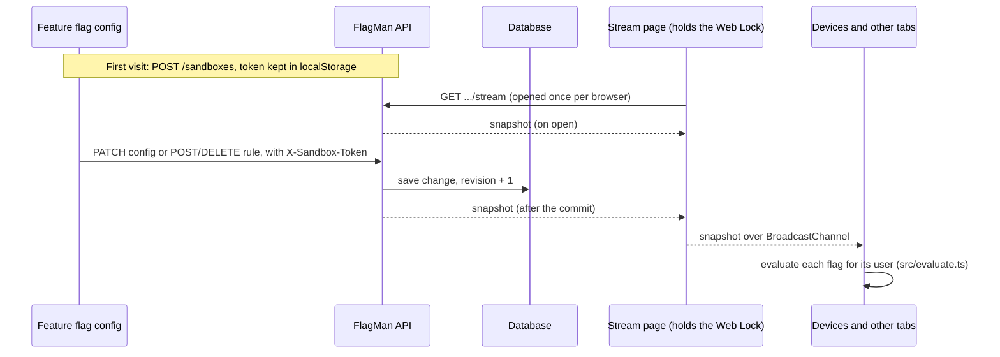

# FlagMan demo

A feature flag only shows its value when you can see the app change for different users. This demo
puts a small feature flag config next to three devices running the same app, so a change to a flag in
[FlagMan](https://github.com/Juice02/Flagman) shows up on each device as soon as it is saved.

Live: https://flagman-demo.onrender.com. The API sleeps when idle, so the first load can take 1–2 minutes.

## What it shows

- **Stage** (`/`): a feature flag config for two flags in one environment, and three device frames. Each
  device is the Book Logger page for a different user:

  | Device | User | Country | Plan | Bucket `dark-mode` | Bucket `hide-non-fiction` |
  |--------|------|---------|------|--------------------|---------------------------|
  | Laptop | ravi | IN | pro | 1 | 10 |
  | Phone | priya | GB | free | 58 | 52 |
  | Phone | noah | US | pro | 88 | 91 |

  A user is in the rollout when `CRC32(flagKey + ":" + userId) % 100 < rolloutPercentage`, so moving a
  rollout from 0 to 100 turns the devices on one at a time. Under each device are its attributes and
  the result and reason for each flag (`FLAG_DISABLED`, `RULES_NOT_MATCHED`, `IN_ROLLOUT`,
  `OUT_OF_ROLLOUT`).

- **Book Logger** (`/app.html?user=…&country=…&plan=…`): a reading app's "Recommended for you"
  page, with static sample books.
  - `dark-mode` switches its theme.
  - `hide-non-fiction` removes non-fiction from the recommendations.

The feature flag config offers an on/off switch, a rollout slider and three preset rules per flag:

| Preset | Rule |
|--------|------|
| Country is not [US \| IN \| GB] | `country NOT_EQUALS <value>` |
| Country is one of [IN,GB \| IN \| GB \| US] | `country IN <value>` |
| Plan equals [pro \| free] | `plan EQUALS <value>` |

Each browser gets its own **sandbox**: a private copy of the two flags in FlagMan, so visitors don't see
each other's changes. The first demo page in a browser asks FlagMan for one (`POST /sandboxes`) and
keeps its project ID and token in `localStorage`; every other demo page in that browser uses the same
one. FlagMan deletes sandboxes unused for a day; the demo then quietly asks for a new one.

Rules added elsewhere (for example in the FlagMan dashboard) still apply; the panel counts them but does not show or change them.

## How changes reach the devices



One page opens a stream to FlagMan (`GET /projects/{id}/environments/{env}/stream`, Server-Sent
Events). FlagMan sends a snapshot of every flag in that environment (enabled, rollout, rules) when the
stream opens and again after each change is committed. That page passes each snapshot to every other
demo page in the browser (the device iframes and other tabs) over a `BroadcastChannel`, and each device
evaluates its flags in the browser with `src/evaluate.ts`, a copy of FlagMan's `Evaluator`. Nothing polls: while no flag changes, the demo sends
no requests. The panel re-reads its configs when a new snapshot arrives, so changes made elsewhere
show up without a reload.

One stream per browser, not per page, because browsers allow only 6 connections per host over
HTTP/1.1: with a stream per page, six open demo pages would leave no connection for anything else and
every request to FlagMan would hang. The page that holds a Web Lock (`navigator.locks`) opens the
stream; when it closes, the lock passes to another open page, which opens the stream instead. Web
Locks need HTTPS or localhost; without them each page opens its own stream. If FlagMan stops, the
browser's `EventSource` keeps retrying; if FlagMan answers with an error instead (a 502 while the host
restarts or wakes up), the browser stops retrying, so the page reopens the stream itself every 3 s. The
devices keep the last snapshot and show a short note until it reconnects.

Until the first snapshot arrives, the page shows "Starting the FlagMan server… N s", counting up. On a
free host the API sleeps when idle and takes about 1–2 minutes to wake; after four minutes the message
changes to "FlagMan isn't responding".

## Running it

Needs Node 22+ and a running FlagMan.

1. **Start FlagMan.** In `../flagman`: `make up`. The API is on http://localhost:8081 and the dashboard
   on http://localhost:8080.
2. **Allow this origin.** The demo calls the API from the browser, which needs CORS. In
   `../flagman/.env` add `http://localhost:5174`:
   ```
   CORS_ALLOWED_ORIGINS=http://localhost:5173,http://localhost:5174
   ```
   then run `make up` again in `../flagman`.
3. **Install.**
   ```sh
   npm install
   cp .env.example .env
   ```
4. **Start the demo.**
   ```sh
   npm run dev      # http://localhost:5174
   ```

Needs [FlagMan](https://github.com/Juice02/Flagman). To host it, see
"Hosting on Render" in FlagMan's README; its `render.yaml` also builds this demo.

`npm test` runs a self-check of the write guard and the device URL parser, and the evaluation cases
shared with FlagMan (plain Node, no test library).

## Environment variables

| Variable | Default | Purpose |
|----------|---------|---------|
| `VITE_FLAGMAN_API_URL` | `http://localhost:8081` | FlagMan API the browser calls |

Every `VITE_` variable is bundled into the page the browser downloads. None of them may hold a key,
token or password. `.env` is git-ignored; only `.env.example` is committed.

## Code

| File | What it does |
|------|--------------|
| `src/allowlist.ts` | The demo flags, users, attribute values and preset rules, plus `checkWrite` and `userFromParams` |
| `src/admin.ts` | `write()`, the only function that changes FlagMan; runs `checkWrite` first |
| `src/flags.ts` | The flag client: this browser's sandbox, one stream per browser shared over a `BroadcastChannel`, `useFlag`, `useFlagState`, `isEnabled` |
| `src/evaluate.ts` | Flag evaluation in the browser, a copy of FlagMan's `Evaluator.java`, and the snapshot shape check |
| `scripts/evaluation-cases.json` | Cases shared with FlagMan (copied from `../flagman/src/test/resources`; keep the two files the same) |
| `src/ControlPanel.tsx`, `src/main.tsx` | Stage page |
| `src/app.tsx` | Book Logger page |
| `src/ServerStatus.tsx` | The "Starting the FlagMan server" message |

## Security

**What the demo enforces**

- **One write path.** Every change goes through `write()` in `src/admin.ts`, which checks it against
  the allowlist in `src/allowlist.ts`. Only these calls get through: PATCH `enabled`/`rolloutPercentage`
  (whole number 0–100) on the two demo flags, POST one of the preset rules, and DELETE a rule that
  FlagMan reports as a preset rule. Writes go to this browser's own sandbox with its token. The demo
  has no code that creates or deletes flags.
- **FlagMan enforces the same limits.** With `FLAGMAN_ADMIN_KEY` set, a sandbox token can only make
  those preset changes on its own sandbox; everything else needs the admin key, which the demo never
  has. The browser-side guard is a second check, not the protection.
- **Untrusted URL parameters.** Book Logger accepts `user`, `country` and `plan` only from allowlists
  and otherwise falls back to a demo user's own values. All text is rendered by React; nothing builds
  HTML from strings.
- **Embedding.** The stage embeds only its own `/app.html`, built from the fixed demo users, and every
  iframe has a `title`.
- **No link to the full dashboard.** The dashboard can change any flag, rule or project, and FlagMan
  has no login, so linking to it from the demo would bypass the presets.
- **Snapshots are checked before use.** Only same-origin pages can use the `BroadcastChannel`, and
  every snapshot, from the stream or the channel, must match the expected shape.
- **Errors.** The UI shows the API's `detail` message or a short fixed line, never a raw response.
  When FlagMan can't be reached, the devices keep the last result and show a short note.
- **Content-Security-Policy.** Production builds only run this site's own scripts and only connect to
  the FlagMan API (a `<meta>` tag added in `vite.config.ts`); the host adds `frame-ancestors 'self'`.
- **Dependencies.** Only the Vite react-ts template packages.

**What it does not protect against**

- **Using up the free tier.** Rate limits and caps slow down one address, but many addresses together
  can still use up a free host's bandwidth or database quota and take the demo offline until it
  resets. Nothing is lost; it is unavailable for a while.
- **Rules are visible in the browser.** Snapshots carry every rule's attribute and value, so anyone
  can read the rules of any sandbox, including other visitors' (sandbox IDs count up). For the demo's
  preset rules that is harmless; real apps would need FlagMan to send full rules only to servers.
- **One shared admin key.** There are no user accounts or history of who changed what. Don't host
  real projects with sensitive data on the same FlagMan.
- **Limits live in memory.** They reset when FlagMan restarts and assume a single instance.
